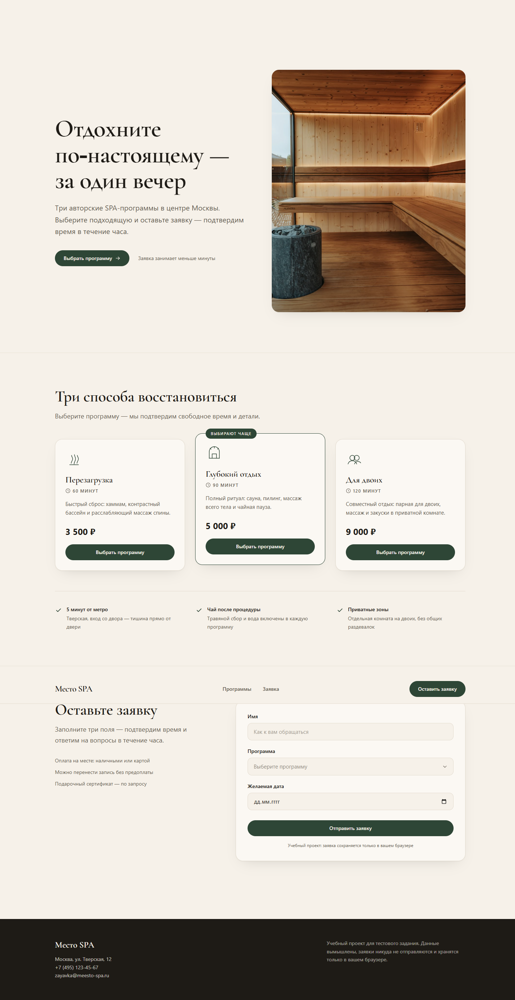
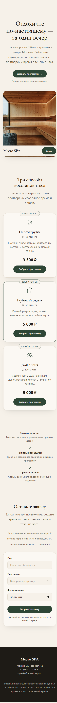

# Место SPA

Одностраничный лендинг вымышленной SPA-студии в центре Москвы — **учебное тестовое задание**
для агентства «Бумеранг». Выбор программы, заявка с валидацией и подтверждение, всё
работает без бэкенда.

**[Открыть сайт](https://meesto-spa.vercel.app)** · Стэк: Vite + React 19 + TypeScript + Tailwind CSS v4



## Что умеет

- **Три программы** из задания — «Перезагрузка» (60 мин, 3 500 ₽), «Глубокий отдых»
  (90 мин, 5 000 ₽), «Для двоих» (120 мин, 9 000 ₽). Кнопка карточки подставляет
  программу в форму и скроллит к ней.
- **Валидация формы**: пустые поля, имя короче двух символов, прошедшая дата —
  понятные инлайн-ошибки, ошибки пропадают сразу после исправления.
- **Подтверждение заявки** с деталями: номер, имя, программа, длительность, цена, дата.
- **localStorage**: заявка переживает перезагрузку страницы и восстанавливается с пометкой.
- **Адаптив**: проверено на 360 и 1440 px, горизонтального скролла нет, тач-цели ≥ 44 px.



## Стек

| Слой | Выбор |
|---|---|
| Сборка | Vite 8 |
| UI | React 19, TypeScript 5.9 |
| Стили | Tailwind CSS 4 (кастомная тема в `@theme`) |
| Шрифты | Cormorant Garamond + Manrope, локально через `@fontsource` |
| Данные | `localStorage`, бэкенда нет |

## Запуск

```bash
npm install
npm run dev      # http://localhost:5173
npm run build    # production-сборка в dist/
npm run typecheck
```

## Структура

```
src/
  components/    # Header, Hero, Programs, ApplicationForm, Footer, иконки
  data/          # программы из ТЗ, форматирование цены
  lib/           # валидация, работа с localStorage
docs/            # разбор ТЗ, дизайн-система, план, QA, AI-workflow, деплой
docs/qa/         # скриншоты проверок (360 и 1440 px, подтверждение заявки)
```

## Дизайн

Направление — «тёплый люкс»: кремовый фон `#F6F1E9`, чернильный текст `#1E1B16`,
моховой акцент `#2E4636`. Кнопки-пилюли, мягкие углы, инлайновые SVG-иконки,
никаких градиентов-подложек, глоу и эмодзи. Полное описание — `docs/03-DESIGN-SYSTEM.md`.

## Как проверялось

- Playwright: сценарий «карточка → форма → ошибки → отправка → подтверждение → перезагрузка»,
  скриншоты 360/1440 px в `docs/qa/`, консоль без ошибок, приватное окно.
- Сканер `kill-ai-slop`: 0 сигналов AI-slop в коде.
- Контраст текста ≥ 4.5:1, `prefers-reduced-motion` отключает анимации, focus-visible виден.

## Ограничения (честно)

Учебный проект: данные вымышлены, заявки никуда не отправляются и хранятся только
в браузере. Форма строго по ТЗ — имя, программа, дата (без телефона и онлайн-оплаты).
